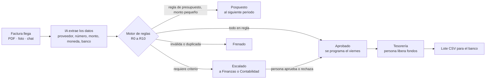

# Contralor

**Reto Blinka · 30X Hackathon 2026: agentes que pagan por la empresa.**

Contralor es un agente de cuentas por pagar. Lee las facturas que llegan por correo, WhatsApp o Slack y decide qué hacer con cada una:

- **pagarla**, y la programa para el viernes;
- **frenarla**;
- **posponerla**;
- **escalarla** a una persona.

Decide siempre dentro de las reglas que la empresa define, y cada decisión queda explicada regla por regla.

> Empresa demo: **Pollos Hermanos, S. A.** (Guatemala), ficticia. Todos los nombres, cuentas, NIT y montos son inventados. No se mueve dinero real.

- **Demo:** https://contralor.lovable.app
- **Video:** <URL del video>

---

## El problema

En una empresa mediana, cuentas por pagar recibe facturas por todos los canales. Una persona revisa a mano si cada factura:

- está a nombre de la empresa;
- no se pagó antes;
- coincide con el contrato;
- cabe en el presupuesto;
- se paga desde una cuenta con saldo.

Es lento, y los errores cuestan dinero: pagos duplicados, cuentas bancarias cambiadas, montos sobre lo pactado.

Contralor automatiza lo rutinario y **solo interrumpe a una persona cuando algo sale de las reglas**.

**Impacto en el set de prueba (18 facturas ficticias de un mes típico):**

- **67 % sin intervención humana.** El agente resuelve 12 de las 18 facturas por sí solo.
- **0 pagos fuera de reglas.** Detuvo los dos duplicados (uno enviado por WhatsApp y una factura ya pagada), el cambio de cuenta bancaria, el sobreprecio del 10 %, el proveedor no registrado y la factura emitida a otra entidad.
- **La persona solo revisa 6 facturas.** Cada una llega con la regla que falló, los números que usó el agente y el área responsable (Finanzas o Contabilidad).

## Cómo funciona

1. **Recepción.** Se sube un PDF o una foto, o se pega el texto de un mensaje de chat.
2. **Extracción con IA.** Un modelo con visión lee el documento y devuelve datos estructurados con su nivel de confianza.
3. **Decisión.** Un motor determinista evalúa las 11 reglas y decide.
4. **Explicación.** Cada factura muestra su decisión, las reglas que fallaron con su detalle y una línea de tiempo auditable.
5. **Aprobación humana.** Las escaladas esperan a una persona, que aprueba o rechaza con un comentario.
6. **Tesorería.** La pantalla muestra saldo por cuenta, total a pagar el viernes y saldo después. Una persona libera los fondos y descarga el lote en CSV. Tesorería también puede hacer pagos parciales o postergar un pago.

## Arquitectura: "agente con barandas"

La regla de diseño principal: **la IA lee; las reglas deciden los pagos.**

| Capa | Qué hace | Tecnología |
|---|---|---|
| Percepción | Lee PDF, imagen o texto y extrae campos con su confianza | Lovable AI Gateway (modelo multimodal) |
| Decisión | Evalúa la política y decide | `src/lib/motorReglas.ts`: función pura `evaluarFactura(factura, contexto)` |
| Contexto | Pagos previos, facturas ya procesadas, presupuesto consumido, saldos | `construirContexto()` lee la base de datos |
| Persistencia y auditoría | Facturas, decisiones, eventos, lotes de pago | Lovable Cloud (Postgres + Storage) |
| Interfaz | Tablero, reglas, proveedores, auditoría, banco de pruebas | React + TypeScript + Tailwind |

**Por qué así:**

- **Seguridad.** El motor solo puede responder PAGAR si **todas** las reglas pasan o no aplican. Un error de la IA no puede aprobar un pago: si la confianza de extracción es baja, la factura se escala.
- **Explicabilidad.** Cada regla devuelve su resultado (OK / FALLA / NO_APLICA / NO_EVALUABLE) y un texto con los números que usó.
- **Reproducibilidad.** La misma factura con el mismo contexto produce siempre la misma decisión.

**Precedencia:** FRENAR > ESCALAR > POSTERGAR > PAGAR. La falla más severa define la decisión.

### La IA, usada con intención

En pagos, una IA que "decide" es un riesgo: puede alucinar, cambiar de criterio o ser manipulada con texto dentro de una factura. Por eso Contralor divide el trabajo:

- **La IA hace lo que las reglas no pueden.** Lee documentos desordenados, como un PDF en inglés, una foto tomada por WhatsApp o un mensaje de Slack sin formato, y los convierte en datos estructurados con su nivel de confianza.
- **Las reglas hacen lo que la IA no debe.** Deciden si se paga, siempre igual y con una explicación verificable.
- **La confianza de la IA es una regla más (R0).** Si la lectura no es segura, la factura no se paga: se escala.
- **Una instrucción escrita en la factura no cambia la decisión.** La IA solo extrae campos, y la decisión la toma el motor con la política de la empresa.

## La política (editable en la pantalla "Reglas")

| Regla | Control | Si falla |
|---|---|---|
| R0 | Confianza de extracción ≥ 0.70 | Escalar |
| R1 | Documento válido y completo (emisor, receptor, número, fecha, monto, moneda) | Frenar |
| R2 | Emitido a nombre de la empresa | Frenar |
| R3 | No es duplicado (pagos previos y facturas ya registradas) | Frenar, con enlace al original |
| R4 | Proveedor registrado, activo y con expediente completo | Escalar a Contabilidad |
| R5 | Datos bancarios iguales a los registrados | Escalar |
| R6 | Monto dentro de ±1 % del contrato o cotización (no aplica a compra directa) | Escalar |
| R7 | Moneda compatible con la cuenta de pago, o conversión autorizada | Escalar |
| R8 | Monto ≤ US$ 25,000 | Escalar a Finanzas |
| R9 | Presupuesto disponible en la categoría | ≤ US$ 5,000: posponer al primer viernes del mes siguiente. Si es mayor: escalar |
| R10 | Saldo suficiente en la cuenta de pago | Escalar |

**Calendario de pagos:** si la factura se recibe lunes o martes, se paga ese viernes. Si se recibe de miércoles en adelante, se paga el viernes siguiente.

## Set de pruebas y criterios del reto

La app incluye 18 casos ficticios:

- 15 PDF;
- 1 foto de WhatsApp;
- 2 mensajes de chat.

Cubren los riesgos reales de cuentas por pagar: un duplicado enviado por otro canal, una factura ya pagada, el sobreprecio contra el contrato, un proveedor no registrado, el tope por pago, el presupuesto agotado, una moneda sin conversión autorizada, un cambio de cuenta bancaria, una factura emitida a otra entidad y un mensaje sin documento.

| Decisión | Facturas |
|---|---|
| Aprobado | 7 |
| Frenado | 4 |
| Escalado | 6 |
| Pospuesto | 1 |

La pantalla **Banco de pruebas** compara cada decisión del motor con la esperada y mide los criterios del reto:

- **Coincidencias:** 18/18.
- **Seguridad:** 0 pagos fuera de reglas.
- **Autonomía:** 67 %. Son 12 de 18 facturas resueltas sin intervención; las 6 restantes requieren criterio humano por política.
- **Doble carga:** cargar el set dos veces no genera pagos duplicados ni sobregira presupuestos.
- **Flujo real:** los 18 casos se procesan por el mismo camino que "Subir factura".

## Cómo probarlo

1. Abre la demo y ve a **Banco de pruebas → Reiniciar datos demo → Cargar los 18 casos en la bandeja**.
2. En el **Tablero**, revisa los pendientes de aprobación, Tesorería y el calendario de pagos.
3. Abre cualquier factura para ver el documento original, los datos extraídos, la decisión, las reglas que fallaron y la línea de tiempo.
4. Aprueba o rechaza una factura escalada. En Tesorería, prueba **Pago parcial**, **Postergar** o **Liberar fondos**.
5. Edita una regla en **Reglas** (por ejemplo, baja el tope por pago) y vuelve a correr el Banco de pruebas.
6. En **Subir factura**, sube un PDF o una foto, o pega un mensaje de chat.

## Cómo lo adoptaría una empresa real

Contralor está pensado para las restricciones de una empresa mediana en Centroamérica:

- **No reemplaza el ERP ni el banco.** Se coloca antes del pago. Recibe las facturas como llegan hoy y entrega un lote CSV que tesorería sube a la banca en línea.
- **Las reglas las configura finanzas, sin programar.** Topes, tolerancias, presupuestos por categoría, cuentas y proveedores se editan en pantalla. Cada cambio crea una nueva versión de la política.
- **Respeta la segregación de funciones que pide un auditor:**
  - el agente prepara;
  - Contabilidad atiende los proveedores nuevos;
  - Finanzas aprueba las excepciones;
  - solo una persona libera fondos.
- **Adopción gradual:**
  1. **Modo sombra** (2 a 4 semanas): el agente propone y la persona confirma. Se mide la coincidencia con el Banco de pruebas.
  2. **Pagos pequeños y recurrentes** en automático.
  3. **Ampliar los topes** según la confianza ganada.
- **Bajo costo:** usa una llamada de IA por factura, solo para leerla. La decisión no consume IA.
- **Auditoría lista:** cada factura conserva el documento original, los datos extraídos, la versión de la política, la traza de reglas y quién aprobó qué y cuándo.

## Seguridad y datos

- Sin datos reales de personas ni empresas.
- Las llaves de API se guardan como *secrets* del backend. Nunca están en el código.
- Las decisiones humanas quedan registradas con usuario, fecha y comentario. Solo una persona puede liberar fondos.
- **Acceso abierto, a propósito.** El demo no tiene inicio de sesión para que el jurado entre directo, y quien actúa se elige en un selector. En producción se activan autenticación, roles (Contabilidad, Finanzas, Tesorería) y políticas de acceso por fila en la base de datos.

## Limitaciones y siguientes pasos

- Leer directamente la factura electrónica FEL (XML de SAT Guatemala) y validar su autorización.
- Integrar correo y WhatsApp reales como canales de entrada.
- Conectar la banca en línea para ejecutar el lote; hoy se exporta en CSV.
- Hacer que la IA redacte el mensaje al proveedor cuando una factura se frena o se escala.
- Manejar más monedas y tipos de cambio en línea.

---

Hecho por **Luis Fernando Samayoa (Luisfer)**, analista de planificación financiera y contador, en Guatemala. Construido con Lovable.
